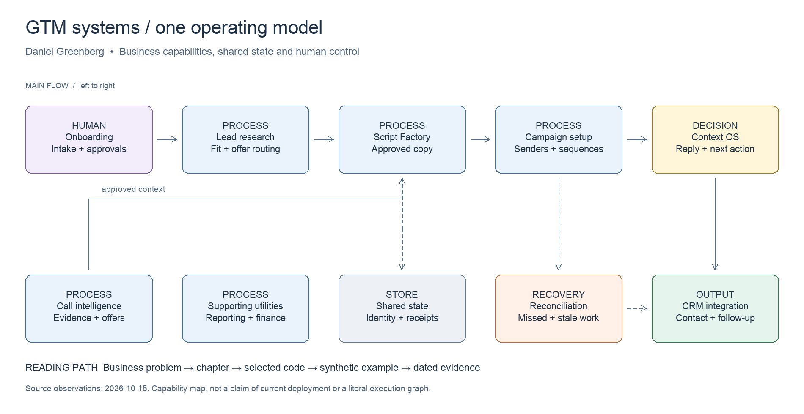

# GTM systems portfolio

**Daniel Greenberg** · Architecture and operating decisions from Outbound Acceleration

I built and operated an outbound business whose daily work depended on connected systems: qualifying accounts, producing approved copy, onboarding clients, handling replies and keeping CRM state consistent. This portfolio shows how those systems fit together and the controls that made their behavior inspectable.

I owned requirements, architecture, workflow sequencing, acceptance criteria and production decisions. Implementation was AI-assisted, including Claude Code. These examples demonstrate my design and operating judgment; I did not hand-code the original TypeScript and SQL line by line.

**Start with the map, open a system, then run its example.**



[Editable overview](diagrams/overview.excalidraw) · [Full system catalog](CATALOG.md) · [Evidence and limitations](evidence/README.md) · [A real retry incident](case-studies/retry-loop.md)

## Explore the systems

| System | Decision to inspect | Start here |
|---|---|---|
| Script Factory | Which claims can the generator use, and when does revision stop? | [Chapter](systems/script-factory/README.md) · [Code](src/script-factory.ts) |
| Onboarding | What is ready, blocked, failed or safe to resume? | [Chapter](systems/onboarding/README.md) · [Code](src/onboarding.ts) |
| Context OS | How does a reply change follow-up across channels? | [Chapter](systems/context-os/README.md) · [Code](artifacts/context-os/event-routing.ts) |
| CRM integration | Which system owns a field, and which entity should change? | [Chapter](systems/crm-integration/README.md) · [Code](src/reconciliation.ts) |
| Reconciliation | How do missed events recover without reopening completed work? | [Chapter](systems/reconciliation/README.md) · [Code](src/reconciliation.ts) |
| Lead research | Does an account fit an approved offer? | [Chapter](systems/lead-research/README.md) · [Code](artifacts/lead-research/offer-routing.ts) |
| Campaign infrastructure | How does an A/B variant differ from a new offer? | [Chapter](systems/campaign-infrastructure/README.md) · [Code](artifacts/campaign-infrastructure/sequence-builder.py) |
| Call intelligence | What did the source establish, and what was actually approved? | [Chapter](systems/call-intelligence/README.md) · [Code](artifacts/call-intelligence/merge-context.ts) |

## Run the examples

Use Node.js 22.18 or newer and npm. Installing development dependencies requires the package registry; the demos and tests make no external API calls and require no credentials.

```sh
npm ci
npm run typecheck
npm test
npm run demo:script-factory
npm run demo:onboarding
npm run demo:reconciliation
```

Pass a different fixture after `--` to any demo. The [examples directory](examples/) contains synthetic inputs and expected decision contracts that check selected result fields. Results are local simulations, including model responses and vendor acknowledgements.

Python 3.10 or newer runs the [sequence builder](artifacts/campaign-infrastructure/sequence-builder.py) and [orchestration wrapper](artifacts/onboarding/run-local-demo.py). Optional diagram rebuilding uses Pillow; see [diagram instructions](diagrams/README.md).

Run `npm run verify` with Node and Python installed for the complete local check. [Recorded traces and verification scope](evidence/local-verification.md) make the simulated outcomes inspectable without installing anything.

## What is evidence here?

- **Adapted source excerpts** preserve selected logic from inspected production source and name the changes made for publication.
- **Simplified demonstrations** implement a small, runnable version of a design. They do not claim full production parity.
- **Historical evidence** reports dated outcomes from retained incident records, including incomplete recovery.
- **Proposed patterns** are labeled as design illustrations.

The OA cold-email service offer was retired in July 2026. The infrastructure continued to support other work. This is a dated engineering portfolio, not a claim that every historical workflow or channel is currently active. Source inspection date: **2026-10-15**.

No production credentials, real client records, private conversations or original repository history are included. Public source excerpts are intentionally small. [Artifact index](ARTIFACTS.md) lists code, SQL, prompts, fixtures and editable visuals.
