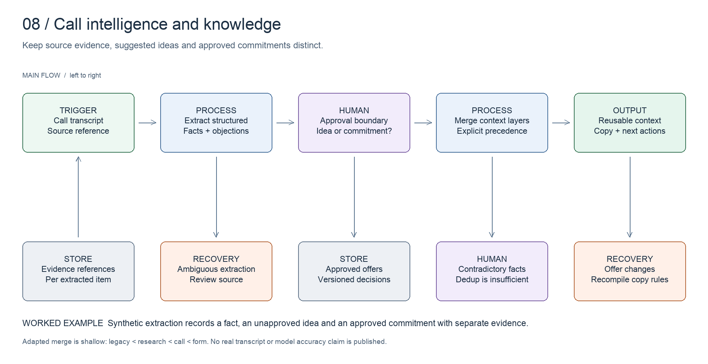

# Call intelligence and knowledge

Turn call evidence into usable context without turning every suggestion into an approved offer.

[All systems](../../README.md) · [Evidence E08](../../evidence/README.md#e08) · [Editable board](../../diagrams/call-intelligence.excalidraw)

## Business problem and implemented design

A transcript mixes facts, objections, ideas and commitments. Those categories should not all become approved campaign promises. The processing chain extracts structured context and preserves the distinction between source evidence and downstream authority.

The inspected call workflow parses extracted pain points, buying signals and objections, merges them into a call-extracted layer, and writes through a dedicated RPC. Source readers merge legacy, research, call and form layers with explicit precedence. A separate offer-extraction path handles approved offers and copy-rule recompilation.

The important boundary is approval: a proposed idea from a call is not automatically permission to pitch it.

## Worked example

The [synthetic extraction](../../artifacts/call-intelligence/extraction-example.json) separates a confirmed business fact, a proposed offer and an approved commitment. It keeps a source reference for each. The [merge excerpt](../../artifacts/call-intelligence/merge-context.ts) shows the inspected layer precedence and case-insensitive list deduplication.

## Design decisions

- Preserve source references and approval state beside extracted content.
- Store call-derived context in its own layer; make precedence visible.
- Recompile dependent copy rules when approved offers change, including removals.
- Treat deduplication as a storage operation. It cannot resolve a factual contradiction.

## Inspect the artifacts

- [Context merge excerpt](../../artifacts/call-intelligence/merge-context.ts)
- [Synthetic extraction](../../artifacts/call-intelligence/extraction-example.json)
- [Extraction prompt](../../artifacts/call-intelligence/extraction-prompt.md)

## Evidence and limits

Source inspected on **2026-10-15**. Evidence E08 records the components and the scope of verification. Code inspection establishes implementation shape, not current deployment health or commercial results.

The fixture is a new synthetic demonstration, not a client transcript. The excerpt's layer merge is shallow and arrays can be replaced by later layers. Case-insensitive deduplication does not reconcile conflicting claims or prove that an extraction is correct.
