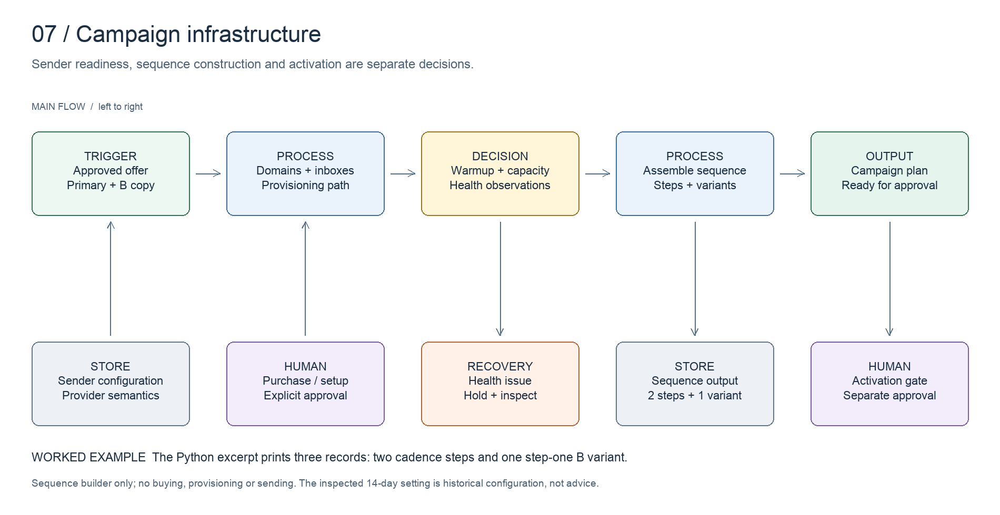

# Campaign infrastructure

Translate approved copy and sender capacity into a controlled campaign configuration.

[All systems](../../README.md) · [Evidence E07](../../evidence/README.md#e07) · [Editable board](../../diagrams/campaign-infrastructure.excalidraw)

## Business problem and implemented design

Campaign infrastructure includes domain and inbox provisioning, sender setup, warmup, capacity and campaign health. Campaign assembly must preserve the meaning of the offer and the intended experiment.

The inspected builder creates primary sequence steps and can append a native step-one variant to the same campaign. An alternative opener for the same offer stays an A/B copy test. It does not require a duplicated offer or a second campaign.

The source has a specific fourteen-day sequence setting. That is a historical OA configuration, not a universal deliverability recommendation. The portfolio avoids universal inbox-volume or warmup claims.

## Worked example

Run `python3 artifacts/campaign-infrastructure/sequence-builder.py`. The sanitized source excerpt prints the step plan for a two-step campaign with a first-step B variant. Three records represent two cadence steps and one alternative first-step copy treatment.

The example produces configuration only. It cannot create campaigns, buy domains or send messages.

## Design decisions

- Distinguish an offer from a copy variant and a cadence step.
- Keep sender readiness and activation approval separate from campaign construction.
- Inspect provider semantics when configuring delay fields.
- Keep health measurements separate from business outcomes such as meetings held.

## Inspect the artifacts

- [Sequence-builder excerpt](../../artifacts/campaign-infrastructure/sequence-builder.py)
- [Readiness checklist](../../artifacts/campaign-infrastructure/readiness.md)
- [Onboarding handoff](../onboarding/README.md)

## Evidence and limits

Source inspected on **2026-10-15**. Evidence E07 records the components and the scope of verification. Code inspection establishes implementation shape, not current deployment health or commercial results.

The excerpt covers sequence construction only. Infrastructure provisioning, sender limits and provider API behavior require live validation before use. Existing production settings are not published as operating advice for another sender.
