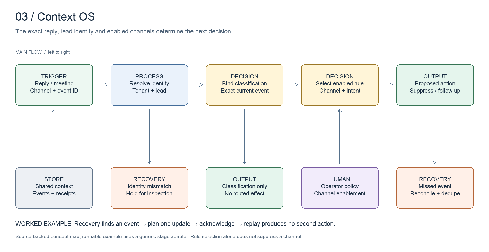

# Context OS

Coordinate follow-up using the same lead context across channels.

[All systems](../../README.md) · [Evidence E03](../../evidence/README.md#e03) · [Editable board](../../diagrams/context-os.excalidraw)

## Business problem and implemented design

A reply on one channel changes what should happen on another. The decision requires a stable lead identity, tenant configuration, the event that arrived and the latest engagement state.

The inspected Context OS workflow validates event bindings, loads tenant configuration and selects suppression rules from the event/channel pair. Its classification-only path can record a classification without routing an external action. A label bound to an older reply is insufficient proof that the current event was processed.

Email and LinkedIn coordination have implementation evidence. Older documents also describe SMS and phone tiers. Those descriptions are historical design intent; this portfolio does not claim every tier was deployed.

## Worked example

A synthetic recovered event stands in for a missed reply webhook and proposes a CRM/context update. An already acknowledged event becomes a no-op. A mismatched identity is held; an older event is marked `older`. Neither changes the current lead.

Run `npm run demo:reconciliation` and inspect [event routing](../../artifacts/context-os/event-routing.ts). The routing excerpt selects a configured rule name; it does not itself stop a channel.

## Design decisions

- Bind classification to the exact event. Lead-level status alone can conceal new replies.
- Separate classification, decision and action. A model answer is not a vendor receipt.
- Read tenant/channel enablement before planning an effect.
- Preserve unknown identity and stale-event states as explicit holds.

## Inspect the artifacts

- [Event-to-rule excerpt](../../artifacts/context-os/event-routing.ts)
- [Reconciliation logic](../../src/reconciliation.ts)
- [Input fixture](../../examples/reconciliation/input.json)
- [Tenant/event schema](../../artifacts/data-model.sql)

## Evidence and limits

Source inspected on **2026-10-15**. Evidence E03 records the components and the scope of verification. Code inspection establishes implementation shape, not current deployment health or commercial results.

The demo has one generic context/CRM adapter. It does not emulate EmailBison or HeyReach, prove channel-wide suppression, or implement all production intent labels. Channel suppression scope and resumption timing depend on configuration and require source-specific verification.
