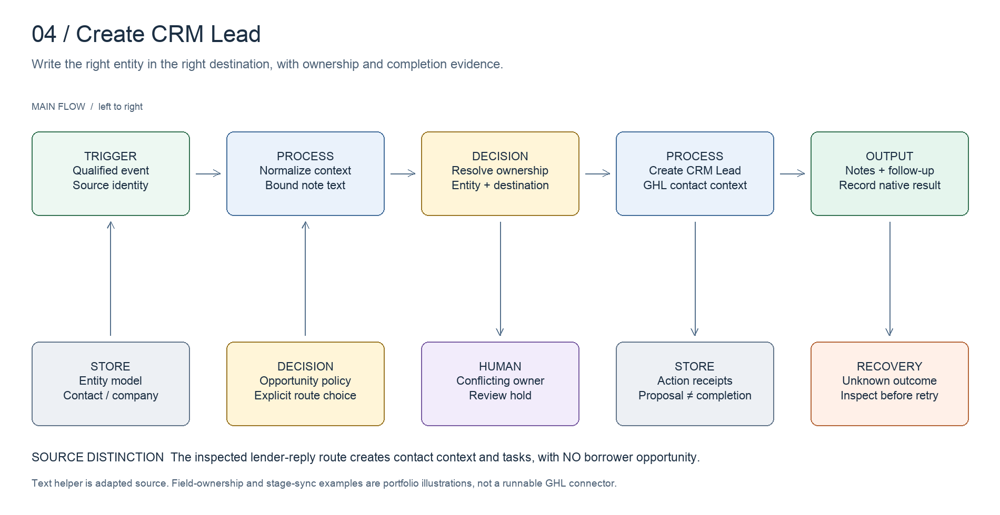

# CRM integration

Keep CRM records aligned with the business process they represent.

[All systems](../../README.md) · [Evidence E04](../../evidence/README.md#e04) · [Editable board](../../diagrams/crm-integration.excalidraw)

## Business problem and implemented design

**Create CRM Lead** writes to GoHighLevel. The inspected lender-reply path creates or updates contact context and follow-up work. It deliberately avoids creating an opportunity in a borrower pipeline.

That distinction matters commercially: contacts, meetings and opportunities measure different things. Copying every positive reply into a convenient pipeline would make the CRM look busy while corrupting the funnel.

The architectural model supports contacts, companies and opportunities as separate concepts. This is not a claim that every inspected route creates all three.

## Worked example

A synthetic reconciliation fixture contains a canonical record at `new`, version 1, and a recovered event requesting `engaged`, version 2. The demo proposes an update only when identity and version checks permit it. The separate human-owner fixture becomes a review hold. A successful fixture acknowledgement records the action so replay does not repeat it.

Run `npm run demo:reconciliation`. Read the [field ownership table](../../artifacts/crm/field-ownership.md) before interpreting the proposed changes.

## Design decisions

- Keep the destination and entity type explicit: a contact, a task and an opportunity represent different work.
- Define field ownership. A newer human decision can be more authoritative than an automated mirror.
- Keep source identity and destination identity separate.
- Record acknowledged effects independently from proposed changes. A transport error can leave the remote outcome unknown.

## Inspect the artifacts

- [Field ownership](../../artifacts/crm/field-ownership.md)
- [Text-normalization excerpt](../../artifacts/crm/normalize-text.ts)
- [Plan and acknowledgement logic](../../src/reconciliation.ts)
- [Relational model](../../artifacts/data-model.sql)

## Evidence and limits

Source inspected on **2026-10-15**. Evidence E04 records the components and the scope of verification. Code inspection establishes implementation shape, not current deployment health or commercial results.

The CRM demo is a generic planning model, not a runnable GHL connector. The field-ownership table is a portfolio design illustration. The text-normalization excerpt is adapted from the inspected route; it does not prove contact deduplication or CRM write reliability on its own.
