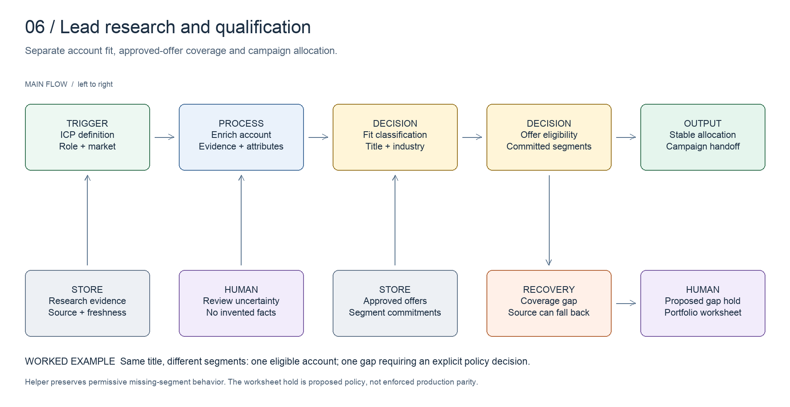

# Lead research and qualification

Connect qualification decisions to the offers that can serve the account.

[All systems](../../README.md) · [Evidence E06](../../evidence/README.md#e06) · [Editable board](../../diagrams/lead-research.excalidraw)

## Business problem and implemented design

Lead research produces inputs such as company type, geography, role and fit evidence. Routing then chooses an eligible offer and campaign. These are separate decisions: an account can fit the market while lacking a suitable approved offer.

The inspected classifier combines configuration, model-extracted attributes and deterministic routing. It derives title and industry grades, checks committed segments, and uses a stable hash for allocation. An explicit coverage-gap flag records when the segment has no matching offer.

The current routing source can fall back to available offers after recording a coverage gap. It also accepts an absent segment in its match helper. This portfolio makes those limits visible rather than calling the route universally fail-closed.

## Worked example

Two fictional accounts have the same job title but different segments. One matches a committed segment; the other produces a coverage gap. The [routing excerpt](../../artifacts/lead-research/offer-routing.ts) preserves the source helper's permissive behavior. The [review worksheet](../../artifacts/lead-research/qualification-example.json) shows how an operator can hold the gap for review.

The worksheet's review hold is a proposed operating policy for this illustration. It is not an assertion that the production classifier enforces that hold.

## Design decisions

- Keep research evidence, fit grade and offer eligibility separately inspectable.
- Bind copy to approved offers and their committed segments.
- Use deterministic allocation where repeated inputs should route consistently.
- Surface coverage gaps explicitly so downstream policy can respond.

## Inspect the artifacts

- [Routing helper excerpt](../../artifacts/lead-research/offer-routing.ts)
- [Synthetic qualification worksheet](../../artifacts/lead-research/qualification-example.json)
- [Approved brief example](../../examples/script-factory/input.json)

## Evidence and limits

Source inspected on **2026-10-15**. Evidence E06 records the components and the scope of verification. Code inspection establishes implementation shape, not current deployment health or commercial results.

The public fixture contains no purchased lead data. It does not reproduce model classification, provider search coverage or enrichment quality. Stable hash allocation is deterministic, not a guarantee of balanced distribution in a small sample.
