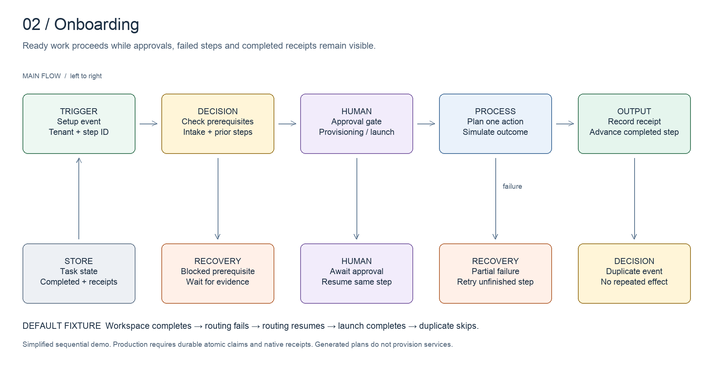

# Onboarding

Move a client through setup without losing approvals or completed work.

[All systems](../../README.md) · [Evidence E02](../../evidence/README.md#e02) · [Editable board](../../diagrams/onboarding.excalidraw)

## Business problem and implemented design

Onboarding spans payments, intake, infrastructure, research, copy and campaign setup. Some work can proceed in parallel; other work must wait for a person or an external system. A single successful parent run is too coarse to describe those states.

The inspected workflow and Python orchestration use phase/task state, manual gates and completed-task checks. The selected phase-picker excerpt continues looking for actionable work after finding a blocked phase. This captures a useful operating choice: a blocked branch should not hide another ready branch.

Historical documents use different phase numbering as the workflow evolved. This chapter names capabilities rather than presenting the March phase diagram as today's exact execution order.

## Worked example

A fictional tenant has supplied intake details and both required approvals. Workspace creation succeeds, routing fails, and the same routing event resumes successfully. Launch then completes. Replaying the workspace event produces no repeated action. The separate [approval-gate fixture](../../examples/onboarding/approval-gate.json) demonstrates a hold when approval is missing; payment is not modeled by this demo.

Run `npm run demo:onboarding`. The local adapter simulates results from the fixture and prints the state changes. It does not purchase domains, provision inboxes or activate a campaign.

## Design decisions

- Prerequisites are data the workflow can inspect. Human approvals have their own event and state.
- Persist completion at the action boundary. A failed step must remain distinguishable from a completed step.
- Scope receipts to the tenant. The same external event ID in another tenant is a different event.
- Resume from recorded work. Avoid rerunning an entire phase because its final step failed.

## Inspect the artifacts

- [State machine](../../src/onboarding.ts)
- [Input fixture](../../examples/onboarding/input.json)
- [Phase-selection excerpt](../../artifacts/onboarding/phase-selection.py)
- [Orchestration wrapper](../../artifacts/onboarding/run-local-demo.py)

## Evidence and limits

Source inspected on **2026-10-15**. Evidence E02 records the components and the scope of verification. Code inspection establishes implementation shape, not current deployment health or commercial results.

The demo is sequential and uses an in-memory state store. Its completed-step receipts illustrate durable state but do not test a real database crash. Production orchestration also needs atomic claims, vendor receipts and a policy for ambiguous outcomes. The Python excerpt documents its historical substring task matching rather than presenting that matching rule as a general recommendation.
