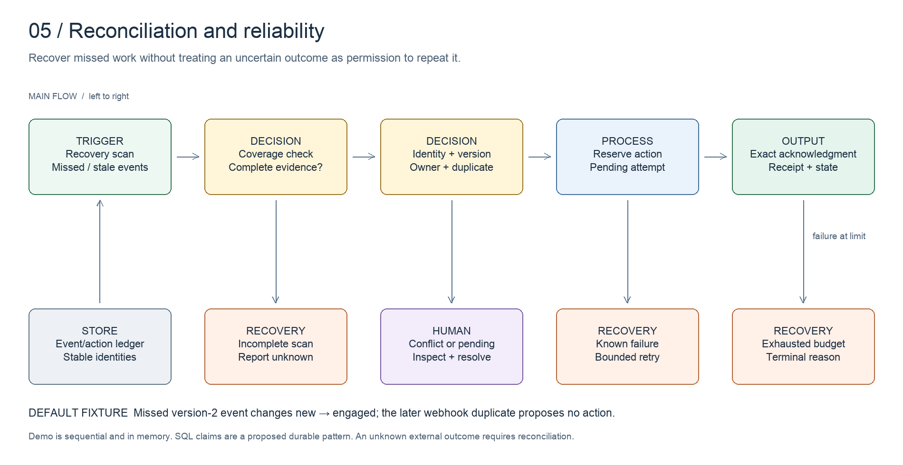

# Reconciliation and reliability

Recover missed work while keeping completed and exhausted work closed.

[All systems](../../README.md) · [Evidence E05](../../evidence/README.md#e05) · [Editable board](../../diagrams/reconciliation.excalidraw)

## Business problem and implemented design

Webhooks provide timely updates. A recovery sweep compares expected state with observed state and finds work a webhook missed. The hard part is deciding whether that work is new, incomplete, already completed or unsafe to repeat.

The inspected reconcilers use bounded lookbacks, explicit diagnostics, provider-state checks and recovery paths. A capped response is incomplete coverage, not proof that the fleet is healthy. Different reconcilers have different contracts; an audit that reports drift is not automatically authorized to repair it.

The March retry incident demonstrates why retries inside one task are insufficient. A reconciler can start a new task and reset that local retry budget unless terminal state persists across both layers.

## Worked example

The local demo covers recovery of a missed event, duplicate acknowledgement, an older event, a conflict and exhausted attempts. Replaying successful work produces no additional completed action.

Run `npm run demo:reconciliation`. Then read the [historical incident](../../case-studies/retry-loop.md) and the [claim illustration](../../artifacts/atomic-claim.sql). The SQL is a proposed durable implementation pattern; the local simulation remains sequential. The default fixture recovers one event and skips its duplicate; the other cases are separate fixtures and tests.

## Design decisions

- Persist terminal state outside the retrying worker.
- Separate unknown remote outcome from confirmed failure. Reconcile ambiguous effects before replay.
- Make claim ownership part of completion. An expired worker must not clear a newer worker's claim.
- Bound scan coverage, execution age and attempts independently.
- Report incomplete coverage explicitly; a partial scan cannot establish zero missing records.

## Inspect the artifacts

- [Recovery logic](../../src/reconciliation.ts)
- [Atomic claim pattern](../../artifacts/atomic-claim.sql)
- [Retry incident](../../case-studies/retry-loop.md)
- [Coverage excerpt](../../artifacts/reconciliation/coverage-check.ts)

## Evidence and limits

Source inspected on **2026-10-15**. Evidence E05 records the components and the scope of verification. Code inspection establishes implementation shape, not current deployment health or commercial results.

The in-memory demo does not establish distributed exactly-once delivery. The SQL is an illustrative Postgres pattern, not an executable deployment migration. Vendor idempotency and readback remain necessary when a worker crashes after an external effect but before recording its receipt.
