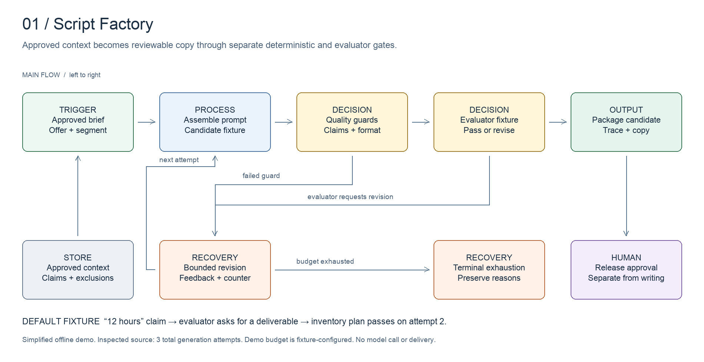

# Script Factory

Turn approved offers into reviewable campaign copy.

[All systems](../../README.md) · [Evidence E01](../../evidence/README.md#e01) · [Editable board](../../diagrams/script-factory.excalidraw)

## Business problem and implemented design

A writer can produce fluent copy that promises something the business never approved. Script Factory puts the approved offer, segment, voice and exclusions ahead of generation. It then separates deterministic checks from a model evaluator.

The inspected workflow loads client inputs, calls and templates into a bill of materials (BOM). It builds the writing prompt, runs quality guards, evaluates the candidate and packages a passing result. The source increments its counter before checking whether it is below three, giving **three total generation attempts**. Packaging and delivery have separate failure paths.

The historical overview says that only A-grade copy ships. That compresses several distinct decisions. Source contains warnings as well as blocking failures, active-version writes, and delivery steps. A generated or stored script does not prove that a campaign was approved or sent.

## Worked example

The fictional retail brief permits the phrase "12 hours." Both candidates stay inside that numeric claim. The first supplied evaluator response asks for a named deliverable; the second candidate names an inventory plan and passes. A separate unsupported-claim fixture demonstrates deterministic rejection. All numbers in these examples are invented inputs, not Daniel's results.

Run `npm run demo:script-factory` from the repository root. Inspect the emitted attempt trace and compare its key fields with the [expected decision contract](../../examples/script-factory/expected.json). The contract is a subset of the full result. Also run the exhaustion and missing-approval fixtures described in the examples directory.

## Design decisions

- Approved offers constrain the writing input. A/B copy variants represent alternative wording of the same offer, not a new offer or second campaign.
- Deterministic guards catch repeatable defects. A separate evaluator assesses qualities that need judgment.
- Revision feedback feeds the next attempt. Exhaustion is a terminal result with reasons, not an invitation to start an unlimited new chain.
- Approved copy and delivery state stay separate. Operators can inspect what passed and what happened afterward.

## Inspect the artifacts

- [Decision logic](../../src/script-factory.ts)
- [Input fixture](../../examples/script-factory/input.json)
- [Writing prompt](../../artifacts/script-factory/writer-prompt.md)
- [Evaluation rubric](../../artifacts/script-factory/evaluator-rubric.md)
- [Copy revision](../../artifacts/script-factory/copy-example.md)

## Evidence and limits

Source inspected on **2026-10-15**. Evidence E01 records the components and the scope of verification. Code inspection establishes implementation shape, not current deployment health or commercial results.

The demo implements a selected policy with fixture model responses. Its numeric-claim check and segment validation are deliberately small; they are not the complete production guard set or a measurement of model quality. A live implementation also needs model-error handling, stored version checks and delivery receipts.
